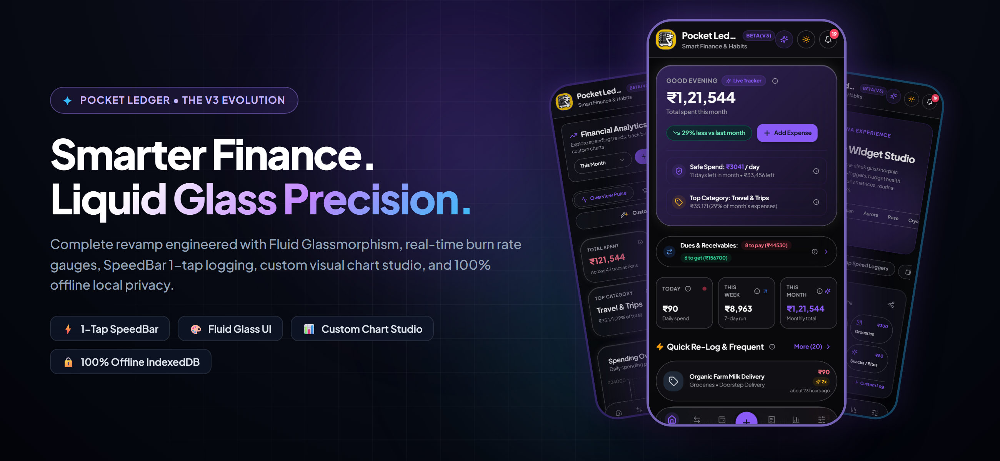
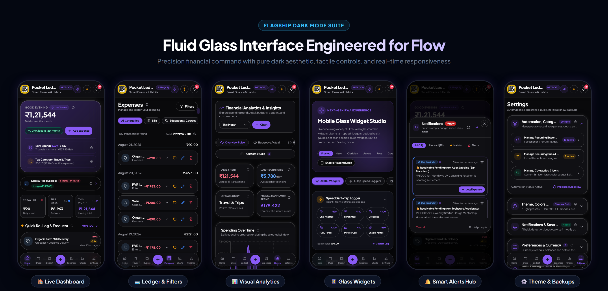
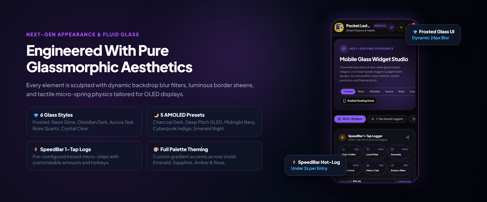
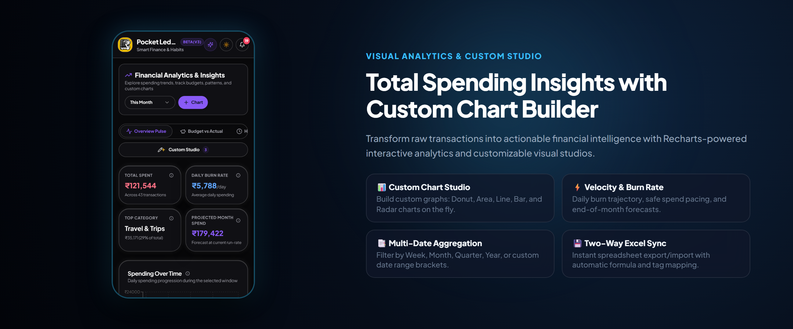

<div align="center">

# ✦ Pocket Ledger
### *Next-Gen Personal Expense Intelligence & Smart Finance Copilot*

[](https://budgetpilotv2.netlify.app/)
[](https://react.dev/)
[](https://www.typescriptlang.org/)
[](https://vitejs.dev/)
[](https://tailwindcss.com/)
[](https://dexie.org/)
[](https://opensource.org/licenses/MIT)

<br />

<p align="center">
  
</p>

<p align="center">
  <b>Fluid Glassmorphic UI</b> • <b>SpeedBar 1-Tap Logging</b> • <b>Custom Chart Studio</b> • <b>Smart Notification Hub</b> • <b>100% Offline Sovereignty</b>
</p>

---

</div>

## 🌌 The V3 Evolution: A Quantum Leap

**Pocket Ledger** is a complete ground-up evolution of personal financial tracking. Re-imagined from the core to eliminate transaction friction, it combines **Fluid Glassmorphic aesthetics**, **instant micro-transaction capture**, **deep visual analytics**, and **sub-millisecond local-first database performance**.

Designed for speed, clarity, and aesthetic pleasure on OLED and modern mobile screens, Pocket Ledger turns daily budgeting into a tactile, effortless experience.

---

## 📱 Flagship Dark Mode Showcase

<div align="center">
  
</div>

<br />

| Flagship View | Core Purpose | Architectural & UX Highlights |
| :--- | :--- | :--- |
| **🏠 Live Dashboard** | Real-time financial command center | Safe spend daily velocity meter, monthly burn rate gauge, instant dues matrix & quick re-log stream |
| **💳 Ledger & Filters** | High-density transaction journal | Instant multi-tag search, fast filter chips, monthly date grouping, inline edit & rollback |
| **📊 Visual Analytics** | Interactive spending intelligence | Recharts donut distributions, daily spending trajectory, cashflow progression & Custom Chart Studio |
| **📱 Glass Widgets Studio** | Rapid micro-logging interface | SpeedBar 1-tap hot chips, 6 glassmorphic presets (*Frosted, Neon, Obsidian, Aurora, Rose, Crystal*) |
| **🔔 Smart Alerts Hub** | Proactive financial notifications | Real-time dues countdowns, budget threshold warnings, sound FX & intelligent habit reminders |
| **⚙️ Theme & Backups** | Deep personalization & sovereignty | 5 AMOLED pitch-dark presets, 6 light themes, custom accent palettes & 2-way Excel (.xlsx) / JSON sync |

---

## 💎 1. Fluid Glassmorphism & Theming Engine

<div align="center">
  
</div>

Pocket Ledger features a custom-engineered **Fluid Glass UI Design System** tailored for modern high-refresh-rate OLED displays:

- **Dynamic 24px Backdrop Sheen**: Multi-layered background blur with luminous neon border highlights and translucent frosted cards.
- **6 Fluid Glass Presets**:
  - `Frosted Glass`: Classic premium frosted crystal with soft ambient diffusion.
  - `Neon Glow`: High-contrast cyber-glow with luminous violet and cyan edge backlights.
  - `Obsidian Dark`: Deep pitch-black stealth surfaces tailored for minimal battery consumption.
  - `Aurora Teal`: Radiant emerald and arctic cyan gradients.
  - `Rose Quartz`: Soft sunset pink and crimson undertones.
  - `Crystal Clear`: High-transparency minimalism with crisp white specular highlights.
- **5 Pure AMOLED Dark Modes**: Switch effortlessly between *Charcoal Dark*, *Deep Pitch OLED (True Black)*, *Midnight Navy*, *Cyberpunk Indigo*, and *Emerald Night*.
- **Tactile Physics & Micro-Springs**: Instant touch feedback with smooth spring compressions and seamless gesture navigation.

---

## 📊 2. Visual Analytics & Custom Chart Studio

<div align="center">
  
</div>

Transform raw financial entries into actionable, visual intelligence with our integrated **Chart Studio**:

- **Custom Chart Builder**: Create and save customized graphs on the fly:
  - **Chart Types**: Interactive Donut Charts, Area Fill Trends, Multi-Bar Comparisons, Line Progressions, and Radar Distribution Maps.
  - **Flexible Dimensions**: Group spending by Category, Payment Method (UPI, Credit Card, Cash, NetBanking), Account, Day, Week, or Month.
  - **Dynamic Time Framing**: Seamlessly aggregate metrics across *Today*, *This Week*, *This Month*, *Quarter*, *Year-to-Date*, or *Custom Date Ranges*.
- **Burn-Rate & Safe Spend Velocity**:
  - Live calculation of **Safe Daily Spend Allowance** (`Remaining Budget ÷ Days Left`).
  - Monthly projected spend trajectory based on real-time spending velocity.
  - Proactive milestone warnings at 75%, 90%, and 100% budget utilization.

---

## ⚡ 3. SpeedBar & 1-Tap Micro Logging

- **Under 2-Second Capture**: Log routine everyday expenses (Chai `₹20`, Lunch `₹150`, Fuel `₹200`, Groceries `₹300`) with a single tap.
- **Smart Frequent Stream**: Automatically learns your most frequent recurring transactions and places them at the top of your dashboard for zero-friction re-logging.
- **Multi-Currency Intelligence**: Native currency formatting with instant switching across **INR (₹)**, **USD ($)**, **EUR (€)**, **GBP (£)**, **JPY (¥)**, and more.

---

## 🔔 4. Intelligent Notification Hub & Recurring Automation

- **Recurring Rules Engine**: Automate monthly rent, recurring subscriptions, SIP investments, and EMI schedules with customizable frequencies (*Daily, Weekly, Monthly, Yearly*).
- **Proactive Dues & Receivables**: Keep track of pending lendings and borrowings with automatic due date countdowns.
- **Interactive Audio Feedback & Sound FX**: Audio haptics and toast alerts for milestone triggers and reminder acknowledgements.

---

## 🔒 5. Zero-Cloud Local Sovereignty & Two-Way Excel Sync

Your financial data belongs exclusively to you. Pocket Ledger operates with **100% local data privacy**:

- **Dexie.js IndexedDB Engine**: Lightning-fast sub-millisecond queries with zero network latency and complete offline persistence.
- **Two-Way Excel (.xlsx) Engine**: 1-click import and export powered by `ExcelJS` with automatic category mapping, formula integrity, and custom column recognition.
- **Full JSON Snapshots**: Instant portable database backup and restore across devices.

---

## 📱 Progressive Web App (PWA) Features

Pocket Ledger is engineered as an installable **PWA (Progressive Web App)** with native app capabilities:

- **Home Screen App Shortcuts**:
  - ➕ **Add Expense**: Instantly launches transaction entry dialog.
  - 🔄 **Dues & Receivables**: Direct jump to pending balances and settlement matrix.
  - 📊 **Spending Charts**: Instant access to Analytics and Custom Chart Studio.
  - 🎯 **Budget Limits**: Check category caps and thresholds.
  - ✨ **Glass Widgets Studio**: Open SpeedBar loggers and glass widgets.
- **Service Worker Caching**: Instant cold-start load times even without an active internet connection.

---

## 🛠️ Architecture & Tech Stack

```
┌──────────────────────────────────────────────────────────┐
│                      Pocket Ledger                       │
├────────────────────────────┬─────────────────────────────┤
│  Frontend & UI Framework   │  Data & Storage Engine      │
│  • React 18.3 + TypeScript │  • Dexie.js (IndexedDB)     │
│  • Vite 5 + Tailwind CSS   │  • TanStack React Query v5  │
│  • Radix UI Primitives     │  • ExcelJS Spreadsheet Engine│
│  • Framer Motion Physics   │  • Zero-Cloud Offline Cache │
├────────────────────────────┼─────────────────────────────┤
│  Visualization & Analytics │  Mobile PWA Capabilities    │
│  • Recharts Visual Library │  • Web App Manifest v3.0    │
│  • Custom Chart Studio     │  • App Shortcuts & Badging  │
│  • Safe Spend Velocity     │  • Background Service Worker│
└────────────────────────────┴─────────────────────────────┘
```

---

## 🚀 Quick Start Guide

### Prerequisites
- **Node.js**: v18.0.0 or higher
- **npm** or **yarn**

### Local Development

```bash
# 1. Clone the repository
git clone https://github.com/kvspraneeth/ET-SEP10.git
cd ET-SEP10

# 2. Install dependencies
npm install

# 3. Start development server
npm run dev
```

Open `http://localhost:5000` in your mobile device browser or desktop.

### Production Build

```bash
# Build optimized production bundle
npm run build

# Start production server
npm start
```

---

## 🌐 Live Deployment

Pocket Ledger is continuously deployed on **Netlify**:

- **Live URL**: [https://budgetpilotv2.netlify.app](https://budgetpilotv2.netlify.app/)
- **Build Command**: `vite build`
- **Publish Directory**: `dist`

---

## 📄 License

Distributed under the [MIT License](LICENSE).

<div align="center">
  <br />
  <sub>Crafted with ❤️ for total financial clarity, liquid glass aesthetics, and complete data privacy.</sub>
</div>
